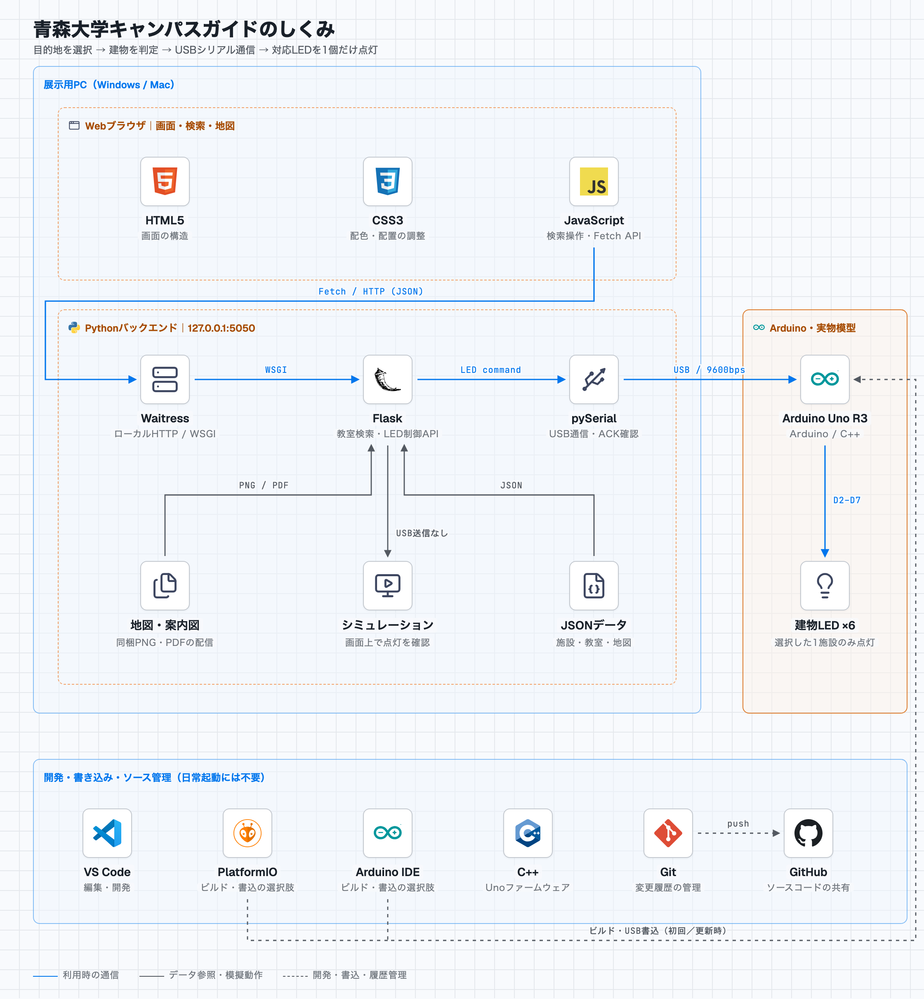

# 青森大学 インタラクティブキャンパスガイド

青森大学「プログラミングワークショップⅡ」で制作する、WebとArduino Uno R3を連携したキャンパス案内です。建物名・確認済みの教室番号から施設を探し、公式マップと実物模型のLEDで案内します。

## できること
- 14施設の一覧・建物名／施設名／確認済み番号の検索、地図13マーカーからの選択
- 369地点（番号付き155室を含む）の階別一覧、出典・該当ページの案内図表示
- 選択した建物とLED状態の表示、全消灯
- Arduinoの接続状態と通信エラーの表示、USBポートの選択・再接続
- 実機と明確に区別したシミュレーション
- Mac / Windowsの起動スクリプトとブラウザの自動表示

**公式アクセスページの全11案内図・15ページを確認し、369地点を登録しています（2026-11-01）。** 例：`5301`、`保健室`、`学修支援センター`、`5号館 トイレ`。建物を選ぶと階別の教室・施設一覧も表示します。棟や階が図面に明記されていない箇所は未記載と表示し、未登録番号は推測で案内しません。資料との照合であり、現地の配置確認は未実施です。[転記範囲と出典](docs/ROOM_DATA.md)を参照してください。

## 使用技術と全体構成

ブラウザで目的地を選び、展示用PCのPythonがUSB経由でArduinoへ命令を送り、キャンパス模型のLEDを点灯させます。

<picture>
  <source media="(prefers-color-scheme: dark)" srcset="docs/diagrams/campus-guide-dark.png">
  
</picture>

青線は利用時の通信、灰色の実線はデータ参照・模擬動作、点線は開発・書き込みの関係です。LEDは現在の設定上6施設で、レストラン棟のD7は仮設定です。

図は[stack-diagram](https://github.com/caru-ini/stack-diagram)で作成しています。[HTML版（保存して開く）](docs/diagrams/campus-guide.html)と[作成手順・出典](docs/diagrams/README.md)も同梱しています。HTML版は構成図を表示するファイルです。

| 担当 | 使用技術 | このシステムでの役割 |
| --- | --- | --- |
| 画面 | HTML5 / CSS3 / JavaScript | 検索フォーム、施設一覧、キャンパスマップ、接続状態を表示する |
| 画面とAPIの通信 | Fetch API / HTTP / JSON | ブラウザから検索・選択・消灯・状態確認をリクエストする |
| バックエンド | Python 3 / Flask | 確認済みデータを検索し、建物を判定してLED制御を受け付ける |
| Webサーバー | Waitress | `127.0.0.1:5050`でHTTPを受け、WSGI経由でFlaskを実行する |
| USB通信 | pySerial | Unoとのシリアル接続、命令送信、応答確認を管理する（9600bps） |
| 案内データ | JSON / PNG / PDF | 施設・教室・階・マーカー座標、公式地図・案内図をPC内に保存する |
| 基板の制御 | Arduino Uno R3 / Arduino Framework / C++ | 命令を検証し、対象のLEDだけを点灯して結果を返す |
| 編集・書き込み | VS Code / PlatformIO または Arduino IDE | PC側コードを編集し、共通のC++プログラムをUnoへ書き込む |
| ソース管理 | Git / GitHub | 変更履歴を記録し、ソースコードと資料を共有する |
| 開発時の検証 | Python unittest / C++の模擬Arduino / Node.js・jsdom | API・検索・通信・画面操作を自動検証する |

通常利用で動作するのはブラウザ、Python、Unoのプログラムです。PlatformIO／Arduino IDEは基板への書き込み時に使い、Node.js・jsdomは開発時のテスト、stack-diagramは文書の図を作成するときだけ使います。

## 検索からLED点灯までの流れ

例として、`5301`を検索し、5号館を案内する場合の処理です。

1. `start.command`／`start.bat`がPython環境を確認し、バックエンドとローカルWebサーバーを起動してブラウザを開きます。
2. ブラウザのJavaScriptが、Fetch APIで`GET /api/rooms?q=5301`を送ります。WaitressがHTTPを受け、Flaskへ渡します。
3. Flaskが確認済みJSONを検索し、「5301・コンピュータ演習室A → 5号館・3階」の情報を返します。画面には教室情報と出典を表示します。
4. 利用者が検索結果を選ぶと、JavaScriptが`POST /api/select`に`{"building_id":"D"}`を送ります。
5. PythonのLEDコントローラーがpySerialで`D\n`をUnoへ送ります。Unoは他のLEDを消し、5号館に対応するD4のLEDだけを点灯して`OK:D\n`を返します。
6. Pythonが応答を確認して画面へ結果を返し、JavaScriptが地図とLED状態を更新します。応答不一致や切断時は、点灯成功と表示せずエラー・状態不明を表示します。

USB接続はPythonが管理し、ブラウザからArduinoへ直接接続するWeb Serial APIは使用しません。シミュレーションの点灯操作はPython内の状態だけを更新し、USBへ送信しません。LEDのない施設は画面・案内図で案内します。

**アプリは起動ファイルから開き、`http://127.0.0.1:5050/`にアクセスしてください。** `frontend/index.html`を`file://`で直接開くと、画面の部品や検索APIを正しく読み込めません。通信仕様の詳細は[システム構成・通信設計](docs/ARCHITECTURE.md)を参照してください。

## 必要な環境
- Python 3.10以上（WindowsではPython LauncherまたはPATH設定が必要）
- Chrome、Edge、Safari等の現在のブラウザ
- 初回セットアップ時のインターネット接続
- 実機利用時: Arduino Uno R3、データ通信対応USBケーブル、設定した6施設分の配線済みLED
- 初回書き込み時: Arduino IDE 2（またはVS CodeのPlatformIO IDE拡張 / PlatformIO CLI）

通常起動にはNode.jsやPlatformIOは不要です。初回にPython依存関係を入れたあとは、地図を含めオフラインで動きます。

## GitHubからダウンロードして使う

1. [GitHubリポジトリ](https://github.com/880null/aomoriuniv-campus-guide)にログインし、「Code → Download ZIP」で取得して展開します。Gitのインストールは不要です。
2. PCにPython 3.10以上を用意します。初回の基板書き込み用にArduino IDE 2も用意します。
3. `firmware/CampusGuide/CampusGuide.ino`をArduino IDEで開き、ボード「Arduino Uno」とUSBポートを選んで「書き込み」を押します。
4. Arduino IDEのシリアルモニターを閉じます。
5. 展開したプロジェクト直下の、Windowsなら`start.bat`、Macなら`start.command`を開きます。Webアプリが起動します。

`CampusGuide`フォルダー内の`src/main.cpp`も必要なので、`.ino`だけを取り出さないでください。
Arduino IDEが起動するのは基板側のプログラムです。PC側のPython/Webアプリは起動ファイルで別に実行します。
書き込みは初回または基板のプログラム更新時だけ必要です。日常の利用ではUSB接続とPC側の起動ファイルだけで使えます。
Arduino IDE経由でも、PC側のPython環境・USB認識・ポート選択の確認は必要です。Windows/Macそれぞれでの実行や基板への書き込みの確認状況は、[検証記録](docs/VALIDATION.md)を参照してください。

## 起動

### Mac
`start.command`をダブルクリックします。ターミナルからも起動できます。

```sh
./start.command
```

実行権限がない場合だけ、プロジェクト内で`chmod +x start.command`を実行してください。

### Windows
`start.bat`をダブルクリックします。

### Arduinoがない場合
通常起動後、画面下の「接続・動作モードの設定」から「シミュレーション」を選べます。最初からシミュレーションで起動することもできます。

```sh
# Mac
./start.command --simulate
```

```bat
rem Windows（コマンドプロンプト）
start.bat --simulate
```

仮想環境`.venv/`を作成して依存関係を確認し、http://127.0.0.1:5050 を自動表示します。Arduinoが見つからなくてもWebアプリは起動します。通常起動は実機モードで、未接続からシミュレーションへ自動的に切り替わることはありません。

起動したターミナルを開いたまま使い、終了時は**Ctrl+C**を押してください。接続中なら全消灯を試みます。ターミナルの強制終了や切断では消灯確認できませんが、ファームウェアは通信が10秒途絶えると全消灯します。

### 起動オプション
Macの`./start.command`、Windowsの`start.bat`の後ろに指定します。

| オプション | 意味 |
| --- | --- |
| `--simulate` | USBを使わないシミュレーション |
| `--no-browser` | ブラウザの自動起動を省略 |
| `--serial-port COM3` | USBポートを明示指定。Macは`/dev/cu.usbmodem...`等 |
| `--port 5051` | HTTPポートを変更 |

ポートは画面でも選べます。Uno候補が複数、または互換ボードの場合は手動指定してください。環境変数`CAMPUS_SERIAL_PORT`も利用できます。

### 手動セットアップ
```sh
python3 -m venv .venv
.venv/bin/python -m pip install -r requirements.txt
.venv/bin/python -m scripts.run --simulate
```

Windowsでは`python3`を`py -3`、`.venv/bin/python`を`.venv\Scripts\python.exe`に読み替えてください。VS Codeの「タスクの実行」には実機/シミュレーションの2タスクを用意しています。

## Arduinoの初回準備

| コマンド/地図記号 | 建物 | ピン |
| --- | --- | --- |
| A | 1号館 | D2 |
| B | 3号館 | D3 |
| C | 4号館 | LED未実装（実機対象外） |
| D | 5号館 | D4 |
| E | 6号館 | D5 |
| F | 7号館 | D6 |
| H | レストラン棟 | D7（仮設定） |
| 0 | 全消灯 | — |

実機LEDは1・3・5・6・7号館とレストラン棟の6施設を設定しています。レストラン棟はユーザー指定でD7に仮設定しているため、実配線を確認してください。
4号館はLED未実装のため、実機へ点灯命令を送りません。施設情報は14施設を案内します。従来の7施設はシミュレーションで点灯表示できます。図書館新館・体育館・創薬棟・新研究棟・弓道場・2号館は画面案内のみです。
旧スケッチとは配線が異なるため、今回の更新時はArduinoへスケッチを再度書き込んでください。

各ピン→220〜330Ω抵抗→LED→GNDと配線します。LEDごとに抵抗が必要です。詳細は[配線と書き込み](docs/HARDWARE.md)を参照してください。

Arduino IDE 2で`firmware/CampusGuide/CampusGuide.ino`を開き、ボードとポートを選んで「書き込み」を押します。ボード定義が未導入の場合は「Arduino AVR Boards」を導入します。

PlatformIOを使う場合:

```sh
cd firmware
pio run
pio run --target upload
```

VS Codeでは`firmware/`をPlatformIOで開いてBuild→Uploadでも書き込めます。初回の書き込み以後は、電源投入時に自動実行されます。アプリの使用前にシリアルモニターを閉じてください。

通信は9600bps、ASCII、LF区切りです。`A\n`に`OK:A\n`、`0\n`に`OK:0\n`が返ります。接続には`READY:CAMPUS:3`の起動通知が必要です。古い配線のv1/v2スケッチは接続を拒否します。詳しくは[通信設計](docs/ARCHITECTURE.md)を参照してください。

## データの追加

- `data/buildings.json`: 施設14件。LEDのない追加施設はpin=null。source_idは参照案内図、symbolは画面上の表示。
- `data/extraction/A.json`〜`K.json`: 目視転記の元データ（ページ・階・区画ごと）。同名室を別々に保持します。
- `data/rooms.json`: 上記から生成する検索用JSON。直接編集せず、転記元を修正して再生成します。
- `data/floorplan_sources.json`: 公式PDFのURL・取得日・ページ数・SHA-256。
- `frontend/static/floorplans/`: 公式PDF11点の未加工コピー。外部接続なしで開けます。
- `data/map.json`: 地図出典と座標。A〜Kは公式記号、新・弓は操作用略記。2号館は全体図で位置を確定できないためマーカーなし。

更新時は大学の資料で確認してから転記元JSONを編集します。`number`・`floor`・`building_id`は未記載の場合nullにし、理由をnoteへ記載します。空白の区画へ名前や番号を補わないでください。

```sh
python scripts/build_room_catalog.py
python scripts/build_room_catalog.py --check
```

生成時に原図のハッシュと全ページの確認記録を検査します。起動時には番号・IDの重複、確認元の不整合、未知の建物、未来の日付などを拒否します。変更後はアプリを再起動してください。データ項目と転記上の留意点は[教室データ](docs/ROOM_DATA.md)にまとめています。

地図は[青森大学公式アクセスページ](https://www.aomori-u.ac.jp/access/)の画像を保存して使用しています。出典、取得日、権利の扱いは[企画経緯](docs/PROJECT_CONTEXT.md)に記録しています。地図画像を差し替えた場合は全マーカーの座標を見直してください。

## プロジェクト構成

```text
AGENTS.md                  Codex向け開発指示
README.md / requirements.txt
docs/
  PROJECT_CONTEXT.md       企画経緯・地図出典
  REQUIREMENTS.md          要件と受入確認
  ARCHITECTURE.md          通信契約・API・モジュール
  HARDWARE.md              配線・書き込み・実機チェック
backend/
  app.py                   Flask APIと画面配信
  catalog.py               JSON検証と検索
  controller.py            USB通信・ACK・モード管理
frontend/
  index.html
  static/                  JavaScript・CSS・公式地図
firmware/
  platformio.ini
  CampusGuide/
    CampusGuide.ino        Arduino IDEで開くファイル
    src/main.cpp           両方の開発環境で共通のUnoプログラム
data/                      施設・教室・マーカーJSON
scripts/                   環境準備とサーバー起動
tests/                     API・検索・模擬通信・ファームウェア論理テスト
start.command / start.bat
```

Web Serial APIは使いません。ブラウザ→Fetch→Flask→pySerial→USB→Uno→LEDの順です。WaitressでFlaskアプリをローカルホストだけに配信し、デバッグと自動リロードは無効です。

## テスト

```sh
.venv/bin/python -m unittest discover -s tests -v
node --check frontend/static/app.js
cd firmware
pio run
```

Pythonテストは65件です。ファームウェアの論理テスト1件にはC++コンパイラ（clang++またはg++）が必要です。シリアル結合テスト11件には、さらにmacOS/LinuxのPOSIX仮想ポートが必要です。条件を満たさないテストはスキップします。Node.jsはJavaScriptの構文確認と、下記のDOM結合テストに使用します。

結合テストでは`Flask API → 実際のpySerial → OSの仮想シリアルポート → 実際のmain.cpp → 模擬ピン出力`をつなぎ、設定した6施設の点灯・消灯、未実装施設の命令拒否、連続選択、切断・再接続、通信停止時の自動消灯を確認します。`Serial`・時計・GPIOは検証用の代替実装です。USB回路、UnoのDTR自動リセット、配線、LEDの実際の点灯を保証するものではありません。

結合テストだけを実行する場合:

```sh
.venv/bin/python -m unittest discover -s tests -p test_serial_integration.py -v
```

検索画面のDOM結合テスト（開発者向け、通常利用には不要）:

```sh
npm --prefix tests ci
npm --prefix tests test
```

Node.jsは`tests/package.json`のenginesを満たす版を使用します。Python仮想環境を準備してから実行してください。別のPythonを使用する場合は`CAMPUS_TEST_PYTHON`で指定できます。jsdom上の実際の画面コードとFlask APIを接続し、番号検索・階別一覧・出典リンク・同名室・非LED施設への移動時の消灯・未接続エラーを検査します。ブラウザの描画や実機USBの検証とは区別します。

確認できた範囲と、実機・OSごとの未確認項目は[検証記録](docs/VALIDATION.md)にまとめています。実際のLED、USB切断・再接続、Windowsの起動は、展示用機材で受入確認してください。

## 困ったとき

| 症状 | 確認すること |
| --- | --- |
| Pythonが見つからない | Python 3.10以上、WindowsのPATH/Launcher |
| 初回のパッケージ導入失敗 | ネット接続、組織のプロキシ設定。次回起動で再試行できます |
| 仮想環境を別PCからコピーした | `.venv`はPC間で持ち運ばず、そのPCで作り直す |
| ブラウザが開かない | ターミナル記載のURLを手動で開く |
| ポート5050が使用中 | 二重起動を確認、または`--port 5051` |
| Unoを検出できない | USBケーブル、ポート一覧更新、手動選択、必要なUSBドライバー |
| 起動通知を確認できない | ファームウェア書き込み、9600bps、他のシリアルアプリ終了。自動RESETしないボードでは接続試行中にRESET |
| 応答不一致/タイムアウト | USB・配線を確認して再接続。画面の点灯成功表示は行いません |
| 教室検索が0件 | 番号を確認する。未登録番号は推測しないため、施設名や建物の階別一覧・原図で探す |

画面は約2秒ごとに実機状態を照会します。USB抜去直後には前の表示が残る場合があります。次の照会失敗で「状態不明」に変わります。複数タブで開くと点灯状態は全タブで共有され、最後に選択した建物が点灯します。

## Git / GitHub

GitHubの保存先は非公開リポジトリ [880null/aomoriuniv-campus-guide](https://github.com/880null/aomoriuniv-campus-guide) です。`origin`から`main`ブランチを管理します。`.venv/`、Pythonキャッシュ、`.pio/`、秘密情報、OS一時ファイルを除外しています。

変更を保存してGitHubに反映する場合:

```sh
git add .
git commit -m "Describe your changes"
git push
```

公開する場合は、同梱した大学地図画像の利用条件も大学に確認してください。
